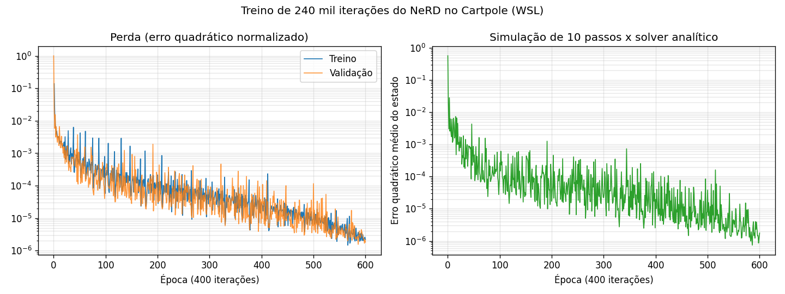
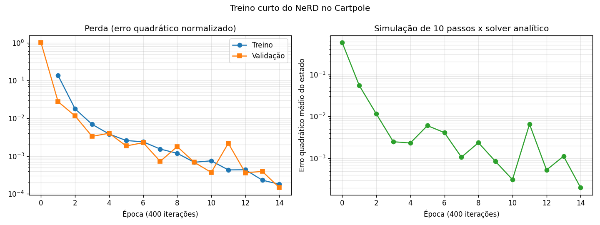
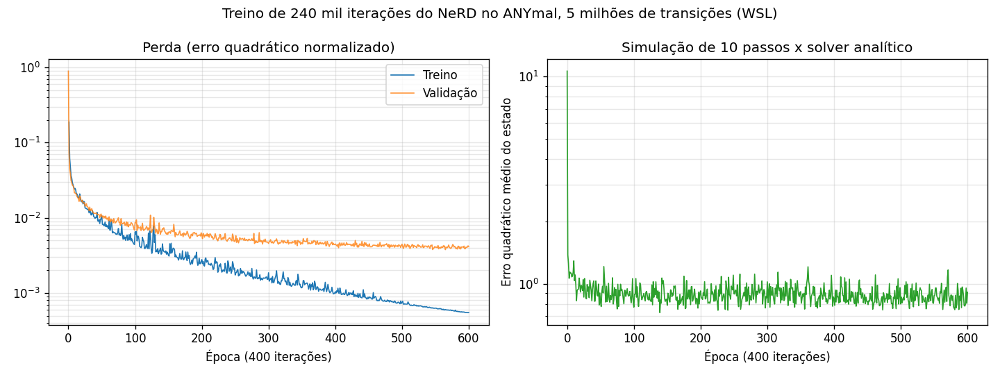
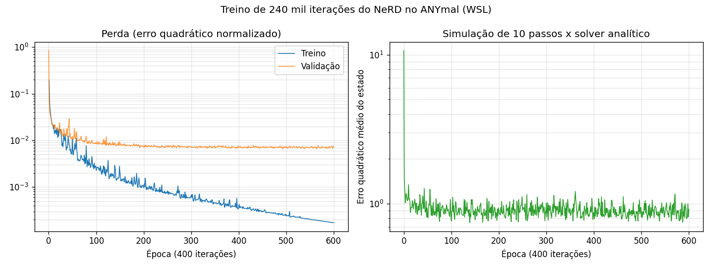
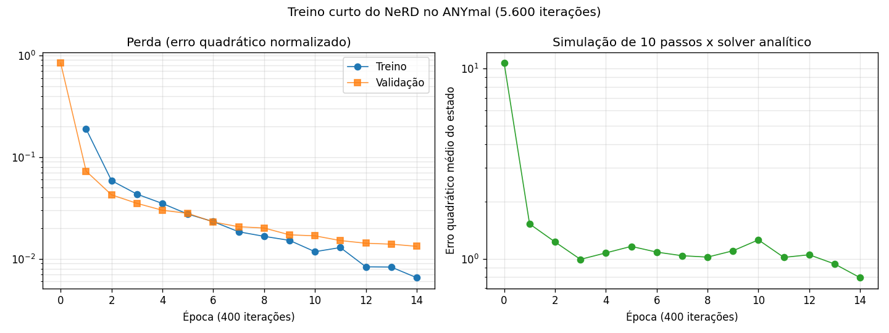

# Solver analítico x solver neural (NeRD)

Comparação prática entre um solver de física matemático e um solver neural, usando os modelos pré-treinados do
**NeRD** (*Neural Robot Dynamics*, Xu et al., CoRL 2025; [artigo](https://arxiv.org/abs/2508.15755),
[código](https://github.com/NVlabs/neural-robot-dynamics)). Nada foi treinado aqui.

O NeRD substitui só a parte de dinâmica e contato do simulador por um Transformer treinado com dados do próprio
simulador. O resto (cena, robô, controle) continua igual, e o mesmo comando roda com um solver ou com o outro:

- `--env-mode ground-truth`: solver analítico do **Warp Sim** (equações de dinâmica de corpos rígidos com contato);
- `--env-mode neural`: o modelo NeRD prevê o próximo estado a partir do estado atual e da ação.

**Sobre o Newton:** o código principal do NeRD roda sobre o Warp Sim, o motor de física que vinha dentro do NVIDIA Warp
e foi substituído pelo **Newton**. O próprio Warp avisa: *"warp.sim is deprecated (...) Please transition to using
the forthcoming Newton library"*. A integração do NeRD como solver do Newton existe no branch
[`nerd_newton_dev`](https://github.com/NVlabs/neural-robot-dynamics/tree/nerd_newton_dev), ainda em desenvolvimento e
com só dois exemplos (Cartpole e Ant).

## Vídeos

Em [`videos/`](videos/), cada vídeo mostra o solver analítico à esquerda e o NeRD à direita, a partir dos mesmos
estados iniciais:

| Vídeo | O que mostra |
|---|---|
| [`cartpole.mp4`](videos/cartpole.mp4) | Cartpole caindo livremente (3 episódios de 200 passos) |
| [`pendulum.mp4`](videos/pendulum.mp4) | Pêndulo duplo batendo no chão (3 episódios de 200 passos) |
| [`anymal_walk.mp4`](videos/anymal_walk.mp4) | Quadrúpede ANYmal andando com a mesma política de RL (400 passos) |
| [`nerd_comparacao.mp4`](videos/nerd_comparacao.mp4) | Os três em sequência (32 s) |
| [`cartpole_treino_curto.mp4`](videos/cartpole_treino_curto.mp4) | Cartpole em três painéis: analítico, NeRD dos autores e o nosso treino curto (ver abaixo) |
| [`cartpole_treinos.mp4`](videos/cartpole_treinos.mp4) | Cartpole em quatro painéis: analítico, autores (5 milhões de iterações) e os nossos treinos de 240 mil e 5.600 |
| [`anymal_walk_treino_curto.mp4`](videos/anymal_walk_treino_curto.mp4) | ANYmal andando: analítico, autores e o nosso treino curto (o robô cai no passo 174) |
| [`anymal_walk_treinos.mp4`](videos/anymal_walk_treinos.mp4) | ANYmal andando em quatro painéis: analítico, autores e os nossos treinos de 240 mil e 5.600 |
| [`anymal_walk_dados.mp4`](videos/anymal_walk_dados.mp4) | ANYmal andando em quatro painéis: analítico, autores e o treino de 240 mil com 5 e com 1 milhão de transições |
| [`anymal_dataset_10x10.mp4`](videos/anymal_dataset_10x10.mp4) | Grade 10×10 com 100 trajetórias de exemplo do conjunto de dados do ANYmal (0,25x) |

## Resultados

### Movimento passivo: erro do NeRD em relação ao solver analítico

2.048 trajetórias de 100 passos, sem ação, partindo dos mesmos estados iniciais. O erro é a média ao longo de toda
a trajetória (logs em [`results/`](results/)).

| Robô | Parâmetros do NeRD | Posição da base | Orientação da base | Juntas |
|---|---|---|---|---|
| Cartpole | 2,7 M | 0,16 mm (carrinho) | — | 0,02° |
| Pêndulo duplo com contato | 2,7 M | — | 0,24° | 0,40° |
| ANYmal (quadrúpede) | 10,9 M | 4,9 mm | 0,33° | 0,32° |
| Ant (quadrúpede) | 10,9 M | 53 mm | 5,1° | 5,2° |

O erro do Ant é muito maior porque o modelo foi treinado com dados do Warp 1.5.1, e aqui a referência foi gerada
com o Warp 1.8.0. O README do NeRD avisa que as duas versões produzem movimentos diferentes; para reproduzir os números
do artigo no Ant, seria preciso o Warp 1.5.1.

### Mesma política de RL nos dois solvers

Política `forward_walk/0` do ANYmal (treinada pelos autores dentro do NeRD), 512 episódios de até 1.000 passos:

| Solver | Recompensa média | Duração média do episódio |
|---|---|---|
| Analítico (Warp Sim) | 1.329,9 | 993,4 passos |
| Neural (NeRD) | 1.327,0 | 991,3 passos |

A política treinada no simulador neural se comporta quase igual no analítico: a diferença de recompensa é de 0,2%.

## Treinos do NeRD no Cartpole

Para ver o processo de treino funcionando (explicado em [`guia_treino_nerd.md`](guia_treino_nerd.md)), treinamos o
NeRD do zero para o Cartpole com a mesma configuração dos autores, mas por bem menos tempo: um treino curto no
Windows e um de cerca de 2h30 no WSL2.

| | Autores | Treino de 240 mil (WSL2) | Treino curto (Windows) |
|---|---|---|---|
| Dados | 1 milhão de transições | Os mesmos 1,02 milhão (10.240 trajetórias de 100 passos), gerados com os mesmos parâmetros | Os mesmos |
| Iterações de treino | 5 milhões | 240 mil (600 épocas de 400), 2h35 | 5.600 (14 épocas de 400), cerca de 25 min |
| Erro passivo de 100 passos: carrinho | 0,16 mm | 4,7 mm | 31 mm |
| Erro passivo de 100 passos: pêndulo | 0,02° | 0,10° | 2,85° |

Mesmo protocolo para os três: 2.048 trajetórias de 100 passos, semente 500, modelo com a melhor avaliação no treino.

### Treino de 240 mil iterações (WSL2)



- Com 43 vezes mais iterações que o treino curto, o erro de 100 passos caiu cerca de 7 vezes no carrinho e 28 vezes
  no pêndulo. Em relação ao modelo dos autores, que treinou 20 vezes mais, o erro ainda é 29 vezes maior no carrinho
  e 4,5 vezes maior no pêndulo.
- As curvas continuam caindo no fim (a taxa de aprendizado decai até a última época), então o modelo também não
  convergiu. A avaliação de 10 passos chegou a 7,4 × 10⁻⁷ (começou em 0,57).
- No vídeo [`cartpole_treinos.mp4`](videos/cartpole_treinos.mp4) o modelo de 240 mil acompanha o analítico de
  perto, ao contrário do treino curto.
- Cada iteração levou cerca de 0,037 s: 0,015 s lendo dados (8 processos na CPU) e 0,020 s de cálculo na GPU.
  Nesse ritmo, as 5 milhões de iterações dos autores levariam cerca de 2 dias.

Log em [`results/treino_3h_cartpole.log`](results/treino_3h_cartpole.log) e avaliação em
[`results/passive_Cartpole_treino_3h.log`](results/passive_Cartpole_treino_3h.log).

No WSL2 (Ubuntu), com o repositório em `~/nerd_ws/nerd`, os dados em `~/nerd_ws/data` e um ambiente em `~/envs/nerd`
(o `/usr/lib/wsl/lib` é onde o WSL coloca a biblioteca CUDA do driver do Windows):

```bash
source ~/envs/nerd/bin/activate
export LD_LIBRARY_PATH=/usr/lib/wsl/lib:$LD_LIBRARY_PATH NERD_DIR=$HOME/nerd_ws/nerd
python nerd_run.py train/train.py --cfg ./cfg/Cartpole/transformer.yaml \
    --logdir $HOME/nerd_ws/data/trained_models/Cartpole/treino_3h_240k --no-time-stamp \
    --cfg-overrides "algorithm.num_epochs 601 algorithm.num_iters_per_epoch 400 algorithm.dataset.num_data_workers 8"
```

Para avaliar e gravar no Windows, copie a pasta do treino (o `cfg.yaml` e o `nn/best_eval_model.pt`) para
`C:\data\trained_models\Cartpole\treino_3h_240k\`.

### Treino curto (Windows)



- O modelo aprende rápido: o erro da simulação de 10 passos usada no treino cai de 0,57 para 0,0002 (quase 3.000
  vezes) e ainda está caindo quando o treino para, então ele não convergiu.
- No teste de 100 passos o modelo curto erra de 125 a 200 vezes mais que o dos autores. Ele só foi avaliado em
  horizontes de 10 passos durante o treino, e em 100 passos os erros se acumulam bem mais.
- O vídeo [`cartpole_treino_curto.mp4`](videos/cartpole_treino_curto.mp4) mostra os três lado a lado, dos mesmos
  estados iniciais: o pêndulo do modelo curto se afasta visivelmente do analítico ao longo de cada episódio.

### Como foi feito

```powershell
$run = "nerd_neural_solver\nerd_run.py"

# 1. Dados (vão para C:\data\datasets\Cartpole: o caminho padrão ../../data sai do repositório)
C:\nerd-env\python.exe $run generate/generate_dataset_contact_free.py --env-name Cartpole --num-transitions 1000000 --dataset-name trajectory_len-100_1M_train.hdf5 --trajectory-length 100 --num-envs 2048 --seed 0
C:\nerd-env\python.exe $run generate/generate_dataset_contact_free.py --env-name Cartpole --num-transitions 200000 --dataset-name trajectory_len-100_valid.hdf5 --trajectory-length 100 --num-envs 2048 --seed 10

# 2. Treino (a pasta de saída precisa ser nova)
C:\nerd-env\python.exe $run train/train.py --cfg ./cfg/Cartpole/transformer.yaml --logdir C:\data\trained_models\Cartpole\treino_curto_6k --no-time-stamp --cfg-overrides "algorithm.num_epochs 15 algorithm.num_iters_per_epoch 400 algorithm.dataset.num_data_workers 0"

# 3. Curvas e avaliação
C:\nerd-env\python.exe nerd_neural_solver\plot_training.py nerd_neural_solver\results\treino_curto_cartpole.log nerd_neural_solver\results\curva_treino_cartpole.png
C:\nerd-env\python.exe $run eval/eval_passive/eval_passive_motion.py --env-name Cartpole --model-path C:/data/trained_models/Cartpole/treino_curto_6k/nn/best_eval_model.pt --env-mode neural --num-envs 2048 --num-rollouts 2048 --rollout-horizon 100 --seed 500
```

O log do treino está em [`results/treino_curto_cartpole.log`](results/treino_curto_cartpole.log). Os modelos
treinados ficam em `C:\data\trained_models\Cartpole\treino_curto_6k\nn\` (melhor avaliação, melhor validação e final).

**Limitações do treino no Windows:**
- **A leitura dos dados é o gargalo.** Com um único processo de leitura, a GPU fica cerca de 75% do tempo ociosa
  (cerca de 22% de uso medido). Com 4 processos, o Windows não consegue enviar o conjunto de dados (cerca de 760 MB
  na memória) para cada um e o treino falha. No Linux isso não acontece, porque os processos compartilham a memória.
- **A pasta de saída precisa ser nova.** Se ela já existe, o treinador consulta uma opção
  (`skip_check_log_override`) que não está nos argumentos do `train.py` público, e o treino falha.

## Treinos do NeRD no ANYmal (quadrúpede)

Mesmo procedimento do Cartpole, agora com o quadrúpede ANYmal e a configuração dos autores
(`train/cfg/Anymal/transformer.yaml`): rede de 10,9 M de parâmetros e, como entrada, além do estado e dos comandos
das 12 juntas, os pontos, normais e profundidades de contato com o chão e a direção da gravidade. O script
[`treinar_anymal.sh`](treinar_anymal.sh) faz tudo no WSL2:

```bash
bash treinar_anymal.sh treino_curto_6k 15 400     # 5.600 iterações (cerca de 6 min)
bash treinar_anymal.sh treino_240k 601 400        # 240 mil iterações (cerca de 4 h)
bash treinar_anymal.sh treino_autores 1001 5000   # 5 milhões, como os autores (cerca de 3,5 dias)
DADOS=5M bash treinar_anymal.sh treino_240k_5M 601 400   # com o conjunto de 5 milhões de transições
```

**Os dados.** O vídeo [`anymal_dataset_10x10.mp4`](videos/anymal_dataset_10x10.mp4) mostra 100 trajetórias de
exemplo, feitas pelo mesmo gerador do conjunto de treino: todas partem do robô em pé e recebem comandos aleatórios nas
juntas, e em 100 passos (1,7 s) o robô se contorce, tropeça ou tomba. São trajetórias equivalentes às do conjunto, não
as mesmas (o sorteio depende do número de ambientes). Para refazer, no Windows:
`C:\nerd-env\python.exe nerd_neural_solver\video_trajetorias_anymal.py`. O script usa a renderização em quadros do
Warp (um robô por quadro) com uma correção: o código do NeRD supõe uma ordem das formas desenhadas que não vale no
ANYmal e falha com `KeyError`, então o script agrupa as formas pelo corpo a que pertencem.

| Conjunto | Transições | Tamanho | Geração |
|---|---|---|---|
| Treino, 1 milhão (`trajectory_len-100_1M_train.hdf5`) | 1,02 milhão (10.240 trajetórias) | 1,07 GB | cerca de 3 min |
| Treino, 5 milhões (`trajectory_len-100_5M_train.hdf5`) | 5,12 milhões (51.200 trajetórias) | 5,4 GB | cerca de 3 min (pico de 13 GB de RAM) |
| Validação (`trajectory_len-100_valid.hdf5`) | 205 mil | 215 MB | cerca de 1 min |

O artigo do NeRD usa 100 mil trajetórias de 100 passos (10 milhões de transições) por robô, com estados iniciais
sorteados. O comando do README do repositório gera só 1 milhão.

| Teste | Analítico | NeRD dos autores (5 milhões de iterações) | 240 mil iterações, dados de 5M | 240 mil iterações, dados de 1M | Treino curto (5.600, dados de 1M) |
|---|---|---|---|---|---|
| Passivo de 100 passos: posição da base | — | 4,9 mm | **9,0 mm** | 21 mm | 35 mm |
| Passivo de 100 passos: orientação da base | — | 0,33° | **0,82°** | 0,89° | 2,5° |
| Passivo de 100 passos: juntas | — | 0,32° | **0,59°** | 1,1° | 2,3° |
| Política de caminhada: recompensa média | 1.329,9 | 1.327,0 | 1.318,2 | **1.329,3** | 241,0 |
| Política de caminhada: duração média do episódio | 993 passos | 991 passos | 995 passos | 993 passos | 195 passos |

Mesmos protocolos dos testes com o modelo dos autores: 2.048 trajetórias passivas de 100 passos (semente 500) e a
política `forward_walk/0` em 512 episódios de até 1.000 passos. Nos nossos treinos, a tabela usa o modelo com menor
perda de validação (`best_valid`). O vídeo [`anymal_walk_treinos.mp4`](videos/anymal_walk_treinos.mp4) mostra o
analítico, o modelo dos autores e os treinos com 1 milhão de transições lado a lado, e
[`anymal_walk_dados.mp4`](videos/anymal_walk_dados.mp4) compara os treinos de 240 mil com 5 e com 1 milhão.

### Treino de 240 mil iterações com 5 milhões de transições (WSL2)



Mesma rede, mesmas iterações e mesmo conjunto de validação do treino abaixo; só o conjunto de treino mudou, de 1 para
5 milhões de transições, para testar a hipótese de que o sobreajuste vinha da falta de dados.

- **Duração:** 600 épocas em cerca de 3 h 55 min (23,5 s por época). O arquivo maior não deixou a leitura mais lenta;
  o processo usou cerca de 23 GB de RAM no WSL.
- **Menos sobreajuste:** a perda de validação não estaciona na época 150; continua caindo devagar até o fim e chega a
  cerca de 4 × 10⁻³ (melhor na época 565), quase metade dos 7 × 10⁻³ do treino com 1 milhão. A perda de treino
  terminou em cerca de 5 × 10⁻⁴ (contra 2 × 10⁻⁴), ou seja, a rede decorou menos.
- **Teste passivo:** o erro caiu à metade: 9,0 mm na posição da base e 0,59° nas juntas, contra 21 mm e 1,1° com
  1 milhão. A orientação quase não mudou (0,82° contra 0,89°). O modelo dos autores ainda erra cerca da metade
  (4,9 mm / 0,33° / 0,32°), com 20 vezes mais iterações e o dobro de dados.
- **Caminhada:** recompensa de 1.318,2 e episódios de 995 passos, praticamente o mesmo que o analítico (1.329,9) e o
  treino com 1 milhão (1.329,3). A diferença de 1% vem de alguns episódios que ainda terminam antes do fim.
- **Qual modelo usar:** de novo, o `best_valid` (época 565) foi muito melhor que o `best_eval` (época 139), que no
  passivo erra 51 mm / 1,65° / 2,2° e na caminhada fica em 1.292,6. A avaliação de 10 passos, ruidosa, ficou entre
  0,75 e 1,25 desde a época 10, como no treino anterior, e não serve para escolher o modelo.
- **Conclusão:** mais dados reduziram o sobreajuste e o erro passivo, e a validação ainda caía no fim do treino. Os
  próximos passos naturais são treinar mais iterações com esses dados e gerar dados com estados iniciais sorteados,
  como no artigo.

Logs em [`results/treino_240k_5M_anymal.log`](results/treino_240k_5M_anymal.log),
`results/passive_Anymal_240k_5M_*.log` e `results/rl_anymal_forward_neural_240k_5M_*.log`. Modelos copiados para
`C:\data\trained_models\Anymal\treino_240k_5M\`.

### Treino de 240 mil iterações com 1 milhão de transições (WSL2)



- **Duração:** 600 épocas de 400 iterações em cerca de 4 h (24 s por época).
- **Sobreajuste:** a perda de treino caiu o tempo todo (até cerca de 2 × 10⁻⁴), mas a de validação estacionou em
  cerca de 7 × 10⁻³ a partir da época 150, e a avaliação de 10 passos ficou entre 0,75 e 1,25 desde a época 10. O
  modelo passou a decorar o conjunto de treino em vez de generalizar. Uma hipótese é que 1 milhão de transições
  seja pouco para um robô com contato. O README do NeRD não informa o tamanho dos dados usados pelos autores no
  ANYmal; a configuração deles admite até 100 milhões de transições (`max_capacity`).
- **Qual modelo usar:** o treinador salva o melhor na avaliação de 10 passos (época 139) e o melhor na validação
  (época 493). O de validação foi melhor nos testes (passivo: 21 mm / 0,89° / 1,1°, contra 43 mm / 2,5° / 2,1° do
  outro) e é o da tabela. Com sobreajuste, a avaliação de 10 passos, que é ruidosa, não escolheu bem.
- **Caminhada:** com os dois modelos, a política anda os episódios inteiros e a recompensa empata com o analítico,
  embora o erro passivo ainda seja 3 a 4 vezes o do modelo dos autores. Uma explicação provável: sem controle, o
  robô desaba e bate o corpo no chão, situação com muitos contatos e mais difícil de prever, enquanto na caminhada
  a política o mantém em pé e corrige pequenos desvios a cada passo. Para avaliar essa política de caminhada, o
  modelo de 240 mil já se mostrou suficiente.

Logs em [`results/treino_240k_anymal.log`](results/treino_240k_anymal.log), `results/passive_Anymal_240k_*.log` e
`results/rl_anymal_forward_neural_240k_*.log`. Modelos copiados para `C:\data\trained_models\Anymal\treino_240k\`.

### Treino curto (5.600 iterações)

- **Dados:** 1 milhão de transições (trajetórias de 100 passos partindo do robô em pé, com comandos aleatórios nas
  juntas e contato com o chão) mais 200 mil de validação, simuladas pelo solver analítico em cerca de 4 min
  (1,07 GB + 215 MB).
- **Treino:** 5.600 iterações (14 épocas de 400), cerca de 6 min. Cada iteração levou 0,060 s, contra 0,037 s no
  Cartpole: metade lendo dados e metade de cálculo na GPU. As 5 milhões de iterações dos autores levariam cerca de
  3,5 dias.



- No teste passivo, o modelo curto erra cerca de 7 vezes mais que o dos autores.
- O teste com a política de caminhada é bem mais exigente: com o modelo curto, os episódios terminam após 195 passos
  em média, em vez de cerca de 990, porque a simulação neural acumula erro até levar o robô a um estado de queda. A
  recompensa cai para 18% da obtida com o solver analítico.
- No vídeo [`anymal_walk_treino_curto.mp4`](videos/anymal_walk_treino_curto.mp4) o robô do modelo curto começa a
  andar como os outros, mas desaba com as pernas abertas no passo 174 (3,5 s); o painel fica parado no último quadro.
- Diferente do Cartpole, a avaliação de 10 passos parou de cair depois da época 3 (oscila entre 0,8 e 1,25), embora as
  perdas de treino e validação continuem caindo. O treino de 240 mil confirmou que esse patamar não cai com mais
  iterações (ver acima).

Logs em [`results/treino_curto_anymal.log`](results/treino_curto_anymal.log),
[`results/passive_Anymal_treino_curto.log`](results/passive_Anymal_treino_curto.log) e
[`results/rl_anymal_forward_neural_treino_curto.log`](results/rl_anymal_forward_neural_treino_curto.log). Para
avaliar no Windows, os modelos foram copiados para `C:\data\trained_models\Anymal\treino_curto_6k\`:

```powershell
C:\nerd-env\python.exe $run eval/eval_passive/eval_passive_motion.py --env-name Anymal --model-path C:/data/trained_models/Anymal/treino_curto_6k/nn/best_eval_model.pt --env-mode neural --num-envs 2048 --num-rollouts 2048 --rollout-horizon 100 --seed 500
C:\nerd-env\python.exe $run eval/eval_rl/run_rl.py --rl-cfg ./cfg/Anymal/anymal_forward.yaml --playback ../../pretrained_models/RL_policies/Anymal/forward_walk/0/nn/AnymalPPO.pth --num-envs 512 --num-games 512 --env-mode neural --nerd-model-path C:/data/trained_models/Anymal/treino_curto_6k/nn/best_eval_model.pt
```

## Como reproduzir

### Instalação (Windows)

```powershell
git clone https://github.com/NVlabs/neural-robot-dynamics.git C:\nerd
cd C:\nerd
git lfs pull                       # os modelos (.pt) ficam no Git LFS

conda create -y -p C:\nerd-env python=3.10
C:\nerd-env\python.exe -m pip install torch --index-url https://download.pytorch.org/whl/cu128
C:\nerd-env\python.exe -m pip install -r C:\nerd\requirements.txt
C:\nerd-env\python.exe -m pip install gym imageio imageio-ffmpeg
```

Também é preciso o `ffmpeg` no PATH (o NeRD o usa para gerar os GIFs).

### Execução

```powershell
nerd_neural_solver\run_all.bat
```

Refaz as métricas, as gravações e os vídeos (cerca de 15 min). Para rodar um script do NeRD isoladamente:

```powershell
C:\nerd-env\python.exe nerd_neural_solver\nerd_run.py eval/eval_rl/run_rl.py --rl-cfg ./cfg/Anymal/anymal_forward.yaml --playback ../../pretrained_models/RL_policies/Anymal/forward_walk/0/nn/AnymalPPO.pth --num-envs 1 --num-games 1 --env-mode neural --render
```

## Arquivos

| Arquivo | Papel |
|---|---|
| [`guia_treino_nerd.md`](guia_treino_nerd.md) | Guia passo a passo de como o NeRD é treinado (geração de dados, janelas, alvos, perda, otimização) |
| [`nerd_codigo/`](nerd_codigo/) | Cópia dos arquivos do NeRD que explicam o solver neural, com guia de leitura |
| `nerd_run.py` | Lançador: roda qualquer script do NeRD com o PyTorch atual (ver abaixo) |
| `make_videos.py` | Junta os GIFs gravados em vídeos lado a lado (2 ou mais painéis) |
| `plot_training.py` | Desenha as curvas de aprendizado a partir do log do treino |
| `plot_comparacao_dados.py` | Compara os treinos do ANYmal com 1 e 5 milhões de transições (curvas de perda e erros do teste passivo) |
| `treinar_anymal.sh` | Gera os dados e treina o NeRD do ANYmal no WSL2 |
| `video_trajetorias_anymal.py` | Grava a grade 10×10 com trajetórias de exemplo do conjunto de dados do ANYmal |
| `run_all.bat` | Refaz as métricas e os vídeos da comparação com os modelos pré-treinados |
| `results/` | Logs das métricas e do treino curto, e as curvas de aprendizado |
| `videos/` | Vídeos de comparação |

## Adaptações em relação ao repositório original

O NeRD foi testado com Python 3.8 e PyTorch 2.2.2 no Ubuntu. Aqui roda no Windows com Python 3.10 e PyTorch 2.11
(CUDA 12.8), necessário para a RTX 5070 Ti. O código da NVIDIA não foi modificado; as diferenças são:

- **Carregamento dos modelos.** Os checkpoints foram salvos como objetos Python completos (`torch.save(model)`).
  A partir do PyTorch 2.6, o `torch.load` recusa isso por padrão (`weights_only=True`), porque carregar um objeto
  Python pode executar código. Em vez de desligar a proteção, o `nerd_run.py` libera só as 20 classes que os
  checkpoints usam (a arquitetura do NeRD, módulos do `torch.nn` e tipos do NumPy), listadas com
  `torch.serialization.get_unsafe_globals_in_checkpoint`.
- **Execução pelo lançador.** O `nerd_run.py` roda o script como se fosse chamado diretamente: põe a pasta dele no
  caminho de importação (o `train.py` importa o `arguments.py` vizinho) e usa a proteção `if __name__ == "__main__"`,
  necessária no Windows para que processos auxiliares não reexecutem o script.
- **Pacote `gym`:** usado pelos scripts de RL e ausente do `requirements.txt`.
- **Aviso `Warp CUDA error: Failed to get driver entry point 'cuDeviceGetUuid'`:** aparece com o Warp 1.8.0 e o
  driver atual, mas a GPU é usada normalmente.
