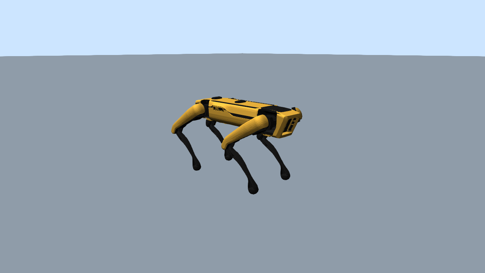

# Spot no Drake

Coloca o Boston Dynamics Spot em cena no [Drake](https://drake.mit.edu/) e salva uma foto.
Roda no **WSL2** (Ubuntu 24.04), porque o Drake não tem versão para Windows.

O Drake não tem um modelo próprio do Spot. O script importa o MJCF do
[MuJoCo Menagerie](https://github.com/google-deepmind/mujoco_menagerie/tree/main/boston_dynamics_spot) com o parser
de MJCF do Drake. O modelo é baixado automaticamente na primeira execução para `~/.cache/mujoco_menagerie`
(dentro do WSL). O robô fica na pose em pé `home` do Menagerie e a física não é executada.



## Requisitos

- WSL2 com a distro `Ubuntu`
- Ambiente `~/envs/drake` (Python 3.11) com `drake` 1.51.1 e `pillow`
- `git` e internet na primeira execução

Para recriar o ambiente (dentro do WSL, sem `sudo`):

```bash
curl -LsSf https://astral.sh/uv/install.sh | sh
uv venv -p 3.11 ~/envs/drake
source ~/envs/drake/bin/activate
uv pip install drake pillow
```

## Como executar

Do Windows: `spot_drake\run_photo.bat`. Dentro do WSL: `bash run_photo.sh`. Opções: `--out`, `--width`, `--height`.

## Como funciona

O Drake monta tudo como um diagrama de sistemas:

1. `MultibodyPlant` + `SceneGraph`: o Spot (do MJCF) e um chão (`HalfSpace`, só visual).
2. Um renderizador VTK registrado no `SceneGraph`, com uma luz direcional vinda de cima e outra presa à câmera.
3. Um `RgbdSensor` preso ao mundo, com o mesmo enquadramento das fotos dos outros simuladores.
   No Drake a câmera olha para +z, com +x à direita e +y para baixo.
4. A pose é aplicada no contexto do `MultibodyPlant` (`SetFreeBodyPose` para a base e `set_angle` por junta)
   e a foto é a saída `color_image` do sensor.

## Observações

- **`Material file [ material.mtl ] not found`:** algumas malhas `.obj` do Menagerie apontam para um `.mtl` que não
  existe. O Drake usa as cores definidas no MJCF, então a foto não é afetada.
- **`libEGL warning ... Permission denied`:** a renderização usa software. Para usar a GPU:
  `sudo usermod -aG render,video $USER` e `wsl --shutdown`.
- O VTK do Drake não desenha sombras por padrão.
