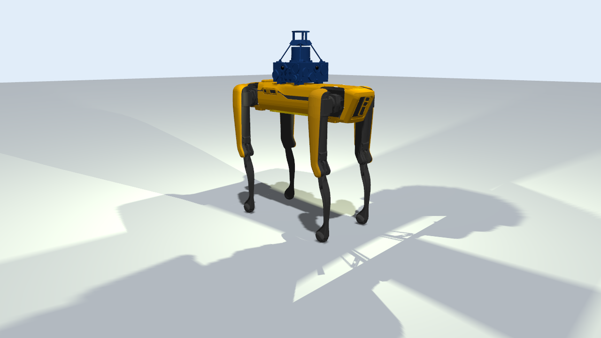

# Spot no Gazebo

Coloca o Boston Dynamics Spot em cena no [Gazebo](https://gazebosim.org/) Harmonic (gz-sim 8.10) e salva uma foto.
Roda no **WSL2** (Ubuntu 24.04).

O Gazebo lê SDF e URDF, não MJCF, então o modelo do Menagerie usado nos outros testes não serve aqui. O mundo inclui o
[`OpenRobotics/bosdyn_spot`](https://app.gazebosim.org/OpenRobotics/fuel/models/bosdyn_spot) do Gazebo Fuel, o Spot
usado pela equipe Explorer no desafio DARPA SubT. Por isso ele vem com um kit de sensores (a torre azul) e lanternas.
O Gazebo baixa o modelo sozinho na primeira execução para `~/.gz/fuel`.

O Spot é incluído como estático, nas juntas zero (pernas esticadas), para a física não derrubá-lo.



## Requisitos

- WSL2 com a distro `Ubuntu` e o WSLg (a renderização usa a tela virtual do WSLg)
- Ambiente `gazebo` do micromamba com `gz-sim8` 8.10.0 do conda-forge
- Internet na primeira execução (download do modelo do Fuel)

O Gazebo normalmente é instalado com `apt`, que exige `sudo`. Aqui ele veio do conda-forge, sem `sudo`:

```bash
# micromamba: binário único, instalado em ~/.local/bin
curl -Ls https://micro.mamba.pm/api/micromamba/linux-64/latest -o /tmp/mm.tar.bz2
python3 -c "import tarfile; t=tarfile.open('/tmp/mm.tar.bz2'); m=t.getmember('bin/micromamba'); m.name='micromamba'; t.extract(m, '$HOME/.local/bin')"

export MAMBA_ROOT_PREFIX=~/micromamba
~/.local/bin/micromamba create -n gazebo -c conda-forge gz-sim8 python=3.11 pillow
```

O conda-forge não tem o Gazebo Jetty (gz-sim 10), citado no relatório. A versão mais nova lá é a Ionic (gz-sim 9);
a Harmonic foi escolhida por ser a versão de suporte longo que acompanha o ROS 2 Jazzy.

## Como executar

```powershell
spot_gazebo\run_photo.bat               # salva spot_gazebo.png (leva uns 10 s)
spot_gazebo\run_photo.bat --gui         # abre também a interface do Gazebo; a foto é salva ao fechar a janela
```

Ou dentro do WSL: `bash run_photo.sh`.

## Como funciona

1. `spot_photo.sdf` define o mundo: sol, chão, o Spot do Fuel e um modelo `photographer` com uma câmera de 1280x720
   no mesmo enquadramento das fotos dos outros simuladores. A câmera grava as imagens em `/tmp/spot_gazebo_frames`.
2. `run_photo.sh` inicia o servidor (`gz sim -s -r`) e se inscreve no tópico de imagem da câmera até receber 3 imagens.
3. O Gazebo é encerrado e a imagem válida mais recente é copiada para `spot_gazebo.png`.

## Observações

- **A câmera só renderiza com alguém inscrito no tópico.** O sistema de sensores do Gazebo pula câmeras sem
  inscritos, e a opção `<save>` do SDF sozinha não conta. Por isso o script usa `gz topic -e`.
- **Imagem truncada.** A última imagem pode estar sendo gravada quando o tópico já publicou; o script copia a mais
  recente que abre sem erro.
- **`--headless-rendering` não funciona no WSL.** Sem acesso a `/dev/dri`, o Ogre2 não consegue um contexto
  OpenGL 3.3 por EGL. Pela tela do WSLg (GLX), a renderização por software funciona.
- **Mensagens esperadas no log:** `Failed to load system plugin [mono-camera-system]` (plugin da SubT que não vem
  no Gazebo padrão), `enable_orientation ... not defined in SDF` e `your 131072x1 screen size is bogus`.
- O modelo da SubT carrega muitos sensores (5 câmeras fisheye, IMU, lidar). Eles não renderizam porque ninguém se
  inscreve nos tópicos deles.
