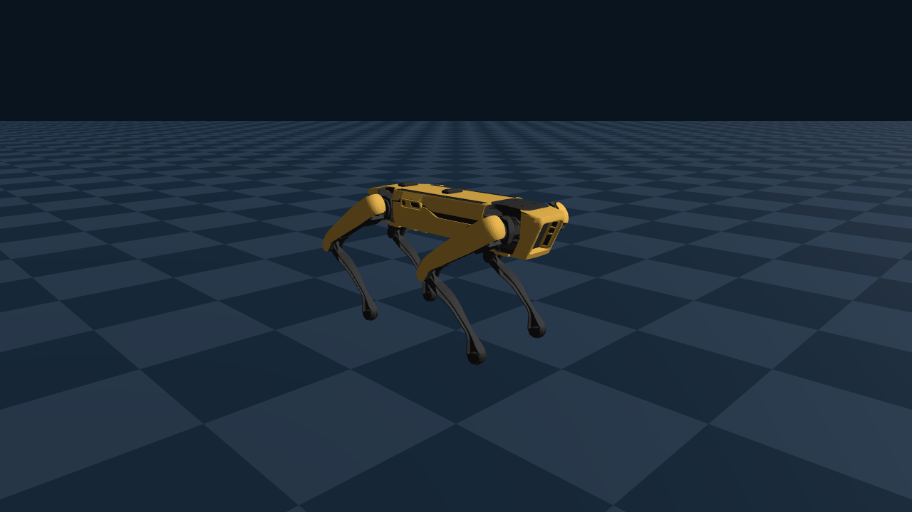

# Spot no Genesis

Coloca o Boston Dynamics Spot em cena no [Genesis](https://github.com/Genesis-Embodied-AI/Genesis) e salva uma foto.
Roda no **WSL2** (Ubuntu 24.04), com a física na GPU (CUDA).

O Genesis não tem um modelo próprio do Spot. Por isso o script usa o MJCF do
[MuJoCo Menagerie](https://github.com/google-deepmind/mujoco_menagerie/tree/main/boston_dynamics_spot),
baixado automaticamente na primeira execução para `~/.cache/mujoco_menagerie` (dentro do WSL).
O robô fica na pose em pé `home` do Menagerie e a física não é executada.



## Requisitos

- WSL2 com a distro `Ubuntu` e a GPU NVIDIA visível (`nvidia-smi` funciona dentro do WSL)
- Ambiente `~/envs/genesis` (Python 3.11) com PyTorch para CUDA 12.8, `genesis-world` 1.4.4 e `pillow`
- `git` e internet na primeira execução

Para recriar o ambiente (dentro do WSL, sem `sudo`):

```bash
curl -LsSf https://astral.sh/uv/install.sh | sh
uv venv -p 3.11 ~/envs/genesis
source ~/envs/genesis/bin/activate
uv pip install torch --index-url https://download.pytorch.org/whl/cu128   # CUDA 12.8 suporta a RTX 5070 Ti
uv pip install genesis-world pillow
```

## Como executar

Do Windows:

```powershell
spot_genesis\run_photo.bat               # salva spot_genesis.png
spot_genesis\run_photo.bat --gui         # salva a foto e abre o visualizador do Genesis
```

Ou dentro do WSL: `bash run_photo.sh`. Opções: `--out`, `--width`, `--height`, `--gui`.

## Observações

- **`libcuda.so lib not found`:** no WSL, o driver CUDA fica em `/usr/lib/wsl/lib`, fora do caminho padrão.
  O `run_photo.sh` adiciona essa pasta ao `LD_LIBRARY_PATH`.
- **`libEGL warning: failed to open /dev/dri/renderD128: Permission denied`:** o usuário do WSL não está no grupo
  `render`, então o OpenGL usa renderização por software. A foto sai normal, mas sem sombras.
  Para usar a GPU também na renderização: `sudo usermod -aG render,video $USER` e reinicie o WSL (`wsl --shutdown`).
- Os avisos sobre atrito, malhas e `qpos0` vêm da conversão do MJCF e não afetam a foto.
