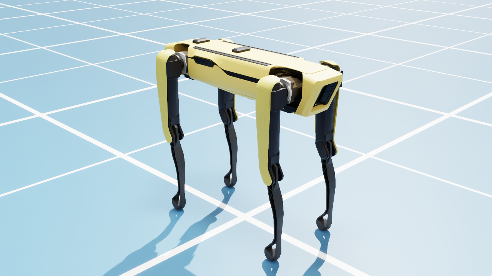

# Spot no Isaac Sim

Coloca o Boston Dynamics Spot (`Isaac/Robots/BostonDynamics/spot/spot.usd`) em cena no Isaac Sim 5.0 e salva uma foto.
O robô fica parado na pose padrão do USD (pernas esticadas) e a física não é executada.
A simulação com o Spot andando está em [../spot_simulation](../spot_simulation).



## Requisitos

- Isaac Sim 5.0 no ambiente conda `C:\isaac-env`
- Internet: o USD do Spot e o chão são baixados do servidor de assets da NVIDIA

## Como executar

```powershell
spot_isaac_sim\run_photo.bat            # salva spot_isaac_sim.png (sem janela)
spot_isaac_sim\run_photo.bat --gui      # salva a foto e deixa o simulador aberto
```

Opções: `--out`, `--width`, `--height`, `--gui`.

## Como funciona

1. Carrega o chão em grade, uma luz ambiente (dome) e uma luz direcional.
2. Referencia o `spot.usd` e mede a caixa delimitadora do robô para apoiá-lo no chão.
3. Cria uma câmera com o Replicator, renderiza alguns frames (path tracing RTX) e salva a imagem do anotador `rgb`.
