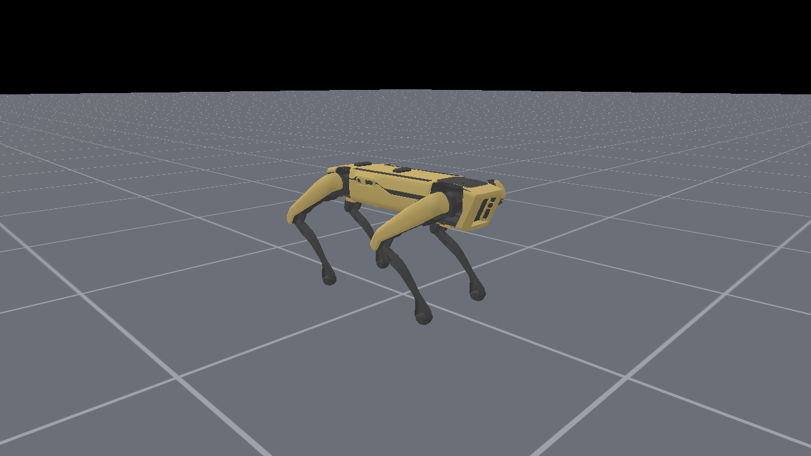

# Spot no ManiSkill3

Coloca o Boston Dynamics Spot em cena no [ManiSkill3](https://github.com/haosulab/ManiSkill) (motor SAPIEN) e salva
uma foto. Roda no **WSL2** (Ubuntu 24.04).

O ManiSkill não tem um modelo do Spot. O script registra um agente `spot_menagerie` a partir do MJCF do
[MuJoCo Menagerie](https://github.com/google-deepmind/mujoco_menagerie/tree/main/boston_dynamics_spot), do mesmo jeito
que o ManiSkill define os robôs dele (UR10e, Humanoid). O modelo é baixado automaticamente na primeira execução para
`~/.cache/mujoco_menagerie` (dentro do WSL). O robô fica na pose em pé `home` do Menagerie e a física não é executada.

O agente já vem com um controlador de posição por junta (`pd_joint_pos`), o que deixa o caminho pronto para
controlar o Spot dentro de um ambiente do ManiSkill depois.



## Requisitos

- WSL2 com a distro `Ubuntu`
- Ambiente `~/envs/maniskill` (Python 3.11) com PyTorch para CUDA 12.8, `mani_skill` 3.0.1 (SAPIEN 3.0.3) e `pillow`
- `git` e internet na primeira execução

Para recriar o ambiente (dentro do WSL, sem `sudo`):

```bash
curl -LsSf https://astral.sh/uv/install.sh | sh
uv venv -p 3.11 ~/envs/maniskill
source ~/envs/maniskill/bin/activate
uv pip install torch --index-url https://download.pytorch.org/whl/cu128
uv pip install mani_skill pillow
```

## Como executar

Do Windows: `spot_maniskill\run_photo.bat`. Dentro do WSL: `bash run_photo.sh`. Opções: `--out`, `--width`, `--height`.

## Observações

- **Renderização na CPU.** O SAPIEN renderiza com Vulkan, e o WSL não tem o driver Vulkan da NVIDIA. O `run_photo.sh`
  aponta o Vulkan para o `lavapipe` (driver do Mesa que roda na CPU), e o script usa `render_backend="cpu"`.
  Funciona para uma foto, mas a renderização paralela em GPU, ponto forte do ManiSkill3, não está disponível no WSL.
  Para isso seria preciso Linux nativo.
- **Dois ajustes na importação do MJCF:**
  - O carregador cria uma raiz extra (`dummy_root`) e mantém o `pos="0 0 .75"` do `<body>` do Spot, que no MuJoCo
    é substituído pela junta livre. O script desce a raiz para o corpo ficar a 0,46 m.
  - O SAPIEN ordena as juntas em largura (todos os `hx`, depois `hy`, depois `kn`), não na ordem do XML.
    Por isso a pose é montada pelo nome de cada junta.
- Os avisos `Failed to find Vulkan ICD file` e `glvnd ICD file` são esperados no WSL; o `run_photo.sh` os filtra.
