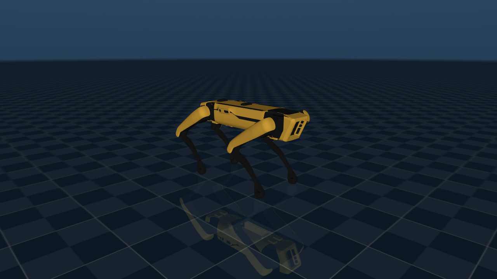

# Spot no MuJoCo MJX

Coloca o Boston Dynamics Spot em cena no [MJX](https://mujoco.readthedocs.io/en/stable/mjx.html), a versão do MuJoCo
em JAX, e salva uma foto. Roda no **WSL2** (Ubuntu 24.04), porque o JAX com GPU não funciona no Windows nativo.

Usa o modelo do [MuJoCo Menagerie](https://github.com/google-deepmind/mujoco_menagerie/tree/main/boston_dynamics_spot)
(`scene.xml`), baixado automaticamente na primeira execução para `~/.cache/mujoco_menagerie` (dentro do WSL).

O que roda onde:

1. O modelo e a pose em pé `home` vão para a GPU (`mjx.put_model`, `mjx.put_data`).
2. O MJX calcula a cinemática na GPU (`mjx.forward`, compilado com `jax.jit`).
3. O MJX não tem renderizador próprio. O estado volta para a CPU (`mjx.get_data_into`) e a foto sai do
   renderizador do MuJoCo, o mesmo usado em [../spot_mujoco](../spot_mujoco).

A física não é executada. O Brax usa o MJX como motor de física, então este teste também cobre a base dele.



## Requisitos

- WSL2 com a distro `Ubuntu` e a GPU NVIDIA visível (`nvidia-smi` funciona dentro do WSL)
- Ambiente `~/envs/mjx` (Python 3.11) com `jax[cuda12]` 0.10.2, `mujoco-mjx` 3.16.0 e `pillow`
- `git` e internet na primeira execução

Para recriar o ambiente (dentro do WSL, sem `sudo`):

```bash
curl -LsSf https://astral.sh/uv/install.sh | sh
uv venv -p 3.11 ~/envs/mjx
source ~/envs/mjx/bin/activate
uv pip install "jax[cuda12]" mujoco-mjx pillow
```

## Como executar

Do Windows: `spot_mjx\run_photo.bat`. Dentro do WSL: `bash run_photo.sh`. Opções: `--out`, `--width`, `--height`.

## Observações

- **`Failed to import warp`:** o MJX tenta carregar o backend opcional MuJoCo Warp, que não está instalado aqui.
  O backend JAX, usado neste teste, não precisa dele.
- **Memória da GPU:** por padrão o JAX reserva 75% da VRAM ao iniciar e mostra erros `CUDA_ERROR_OUT_OF_MEMORY`
  se parte dela já estiver em uso. O script define `XLA_PYTHON_CLIENT_PREALLOCATE=false` para evitar isso.
- **`libEGL warning ... Permission denied`:** a renderização usa software (sem sombras e mais escura que a foto
  do MuJoCo no Windows). Para usar a GPU: `sudo usermod -aG render,video $USER` e `wsl --shutdown`.
