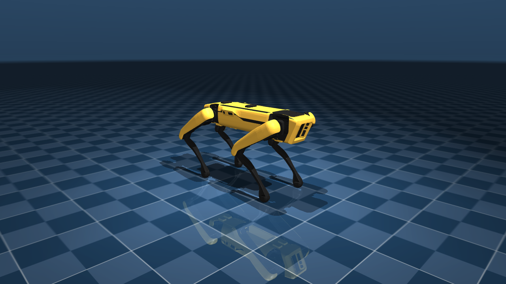

# Spot no MuJoCo

Coloca o Boston Dynamics Spot em cena no [MuJoCo](https://mujoco.org/) e salva uma foto.

Usa o modelo do [MuJoCo Menagerie](https://github.com/google-deepmind/mujoco_menagerie/tree/main/boston_dynamics_spot)
(`scene.xml`: robô, chão e iluminação). Na primeira execução, o script baixa só a pasta do Spot com um clone esparso
do git para `%LOCALAPPDATA%\mujoco_menagerie`. O robô fica na pose em pé `home` do Menagerie e a física não é executada.



## Requisitos

- Ambiente conda `C:\mujoco-env` (Python 3.11) com `mujoco` 3.16.0 e `pillow`
- `git` no PATH e internet na primeira execução

Para recriar o ambiente:

```powershell
conda create -y -p C:\mujoco-env python=3.11
C:\mujoco-env\python.exe -m pip install mujoco pillow
```

## Como executar

```powershell
spot_mujoco\run_photo.bat               # salva spot_mujoco.png
spot_mujoco\run_photo.bat --gui         # salva a foto e abre o visualizador interativo do MuJoCo
```

Opções: `--out`, `--width`, `--height`, `--gui`.

## Como funciona

1. Carrega o `scene.xml` e aplica o keyframe `home` com `mj_resetDataKeyframe`.
2. Aumenta o framebuffer fora da tela (o padrão é 640x480) para o tamanho pedido.
3. Renderiza com `mujoco.Renderer`, o mesmo renderizador OpenGL usado por benchmarks como o LIBERO.
   A câmera tem o mesmo enquadramento das fotos do Isaac Sim e do Newton.
