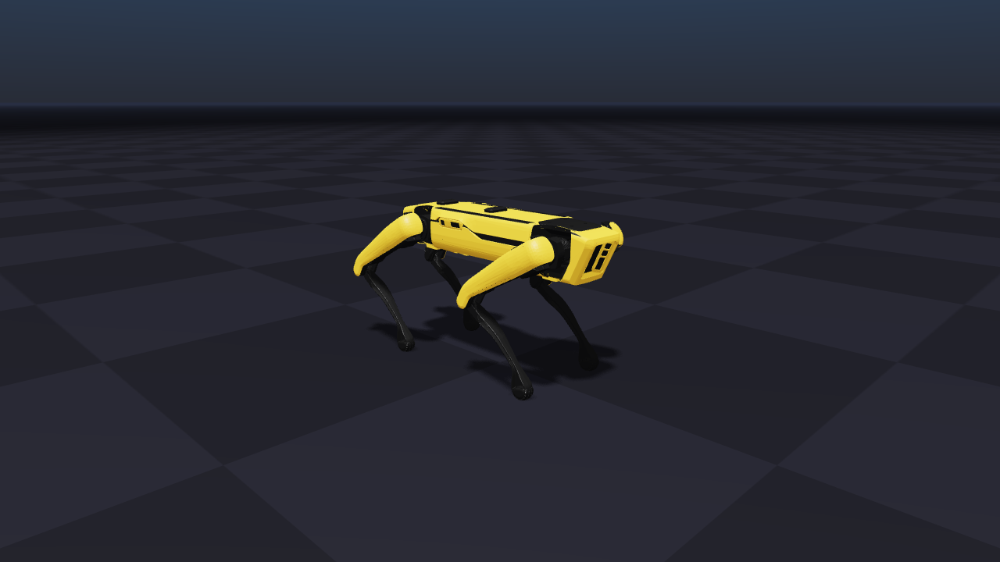

# Spot no Newton

Coloca o Boston Dynamics Spot em cena no [Newton](https://github.com/newton-physics/newton) e salva uma foto.

O Newton não tem um modelo próprio do Spot (o repositório `newton-assets` não inclui o robô).
Por isso o script usa o MJCF do [MuJoCo Menagerie](https://github.com/google-deepmind/mujoco_menagerie/tree/main/boston_dynamics_spot),
baixado automaticamente na primeira execução. O robô fica na pose em pé `home` do Menagerie e a física não é executada.



## Requisitos

- Ambiente conda `C:\newton-env` (Python 3.11) com `newton[examples]` 1.7.0 e `pillow`
- Internet na primeira execução (download do modelo do Menagerie)

Para recriar o ambiente:

```powershell
conda create -y -p C:\newton-env python=3.11
C:\newton-env\python.exe -m pip install "newton[examples]" pillow
```

## Como executar

```powershell
spot_newton\run_photo.bat               # salva spot_newton.png
spot_newton\run_photo.bat --gui         # salva a foto e abre a janela do visualizador
```

Opções: `--out`, `--width`, `--height`, `--gui`.

## Observações

- O aviso `Warp CUDA error 304 ... wp_cuda_graphics_register_gl_buffer` é esperado nesta máquina.
  O Warp não consegue compartilhar buffers entre CUDA e OpenGL e passa a copiar os dados pela CPU.
  A foto sai normal.
- A pose `home` vem do `spot.xml` do Menagerie: base a 0,46 m e, em cada perna, `hx = 0`, `hy = 1,04`, `kn = -1,8`.
