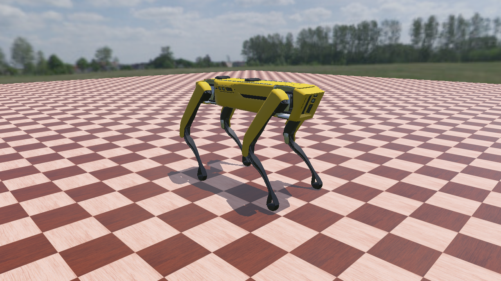

# Spot no Webots

Coloca o Boston Dynamics Spot em cena no [Webots](https://cyberbotics.com/) R2025a e salva uma foto.

O Webots já traz um modelo do Spot (`Spot.proto`, com licença CC BY 4.0). O arquivo é baixado do GitHub da
Cyberbotics na primeira vez que o mundo é aberto. O Spot fica parado na pose em pé do controlador de exemplo
`spot_moving_demo`. Diferente dos outros simuladores, aqui a física roda: o robô se acomoda por 2 s antes da foto.



## Requisitos

- Webots R2025a instalado em `%LOCALAPPDATA%\Programs\Webots`
- Python 3 no PATH, usado pelos controladores (testado com o Python 3.14 do sistema)
- Internet na primeira execução (o Webots baixa o modelo do Spot, o chão e o céu)

Para instalar o Webots sem permissão de administrador, use o instalador do
[release R2025a](https://github.com/cyberbotics/webots/releases/tag/R2025a):

```powershell
webots-R2025a_setup.exe /VERYSILENT /SUPPRESSMSGBOXES /NORESTART /CURRENTUSER
```

## Como executar

```powershell
spot_webots\run_photo.bat               # abre o Webots minimizado, salva spot_webots.png e fecha
spot_webots\run_photo.bat --gui         # salva a foto e deixa o Webots aberto
```

## Estrutura

A pasta segue o formato de projeto do Webots:

| Arquivo | Papel |
|---|---|
| `worlds/spot_photo.wbt` | Mundo: céu, chão, o Spot e o robô `PHOTOGRAPHER` |
| `controllers/spot_stand/spot_stand.py` | Controlador do Spot: põe os 12 motores na pose em pé |
| `controllers/spot_photo/spot_photo.py` | Controlador do fotógrafo: espera 2 s, salva a imagem da câmera e fecha o Webots |

O fotógrafo é um robô sem corpo, só com uma câmera de 1280x720 posicionada com o mesmo enquadramento das fotos
dos outros simuladores. Usar uma câmera, em vez de capturar a vista 3D com `exportImage`, garante a resolução e
evita que as janelas das câmeras do próprio Spot apareçam sobrepostas na imagem.

## Observações

- Na primeira execução, a foto pode sair sem texturas porque o Webots ainda está baixando os modelos.
  Rode de novo e ela sai correta.
- O instalador do Webots R2025a não é assinado digitalmente, e o GitHub não publica hash para ele.
